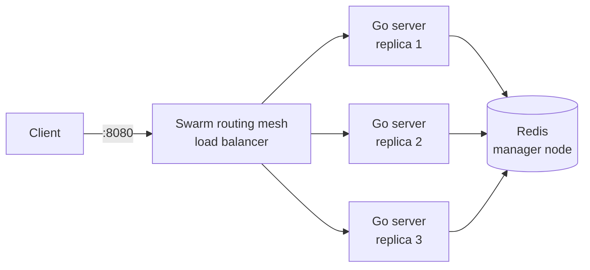

# Key-Value Service

A horizontally scaled key-value store. Three stateless Go servers run as a Docker Swarm
service behind Swarm's load balancer, and share one Redis instance for storage.

## Architecture



- **Stateless servers, shared state.** The Go servers keep nothing in memory. Every read and
  write goes to Redis, so any replica can answer any request, and a replica can be added,
  removed or restarted without losing data.
- **Load balancing.** Port 8080 is published through Swarm's ingress routing mesh, which
  spreads requests across the three replicas. A request to any node in the swarm reaches a
  healthy replica, even on a node that runs none.
- **Fault tolerance.** The service runs with `restart_policy: on-failure`, so Swarm restarts a
  crashed replica and the other two keep serving in the meantime.
- **Service discovery.** Replicas reach Redis by the service name `redis` over Swarm's overlay
  network, wherever the Redis container is scheduled.
- **Bounded memory.** Redis is capped at 256 MB with `allkeys-lru` eviction, so under memory
  pressure the least recently used keys are dropped and writes keep succeeding.
- **Placement.** Redis is pinned to a manager node with a placement constraint. The servers can
  run on any node.

## API

| Request | Effect |
| --- | --- |
| `GET /?key=<key>&value=<value>` | Stores `value` under `key` |
| `GET /<key>` | Returns the value, or `404` if the key does not exist |

```bash
curl "localhost:8080/?key=city&value=toronto"
curl localhost:8080/city    # toronto
```

## Running

Requires Docker with Swarm mode enabled (`docker swarm init`).

```bash
./scripts/setup.sh      # build the server image and deploy the stack as "keyvalue"
./scripts/shutdown.sh   # remove the stack
```

Scale the server tier while the stack runs:

```bash
docker service scale keyvalue_server=5
```

## Limits

- Redis is a single instance, so it is the one component without a replica. Losing the
  manager node that hosts it makes the store unavailable.
- Keys live only in memory. Redis runs without persistence, so a Redis restart clears the
  store.
- Making the storage tier distributed would mean Redis replication with Sentinel for
  failover, or Redis Cluster to shard keys across nodes.

## Stack

Go, `go-redis`, Redis, Docker, Docker Swarm.
